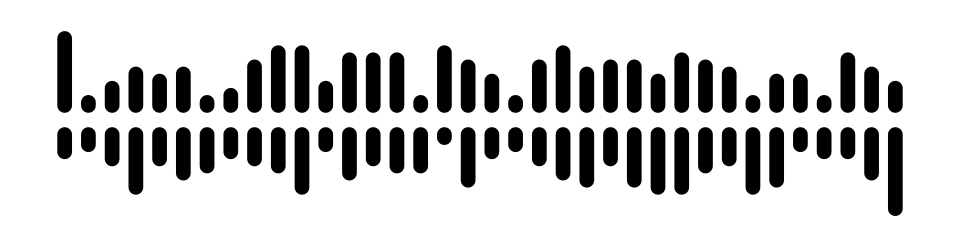
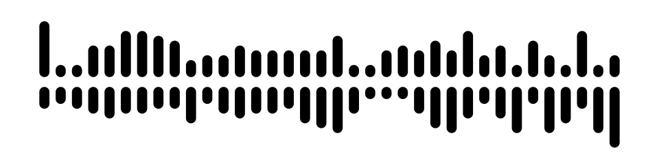
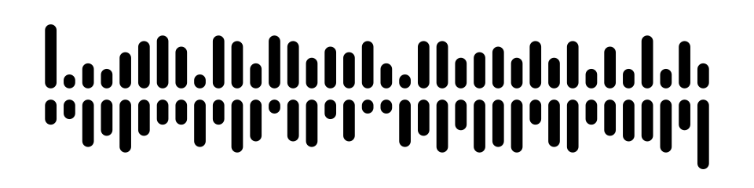

<p align="center">
  <picture>
    <source media="(prefers-color-scheme: dark)" srcset="./assets/brand/wavecode-mark-light.svg">
    
  </picture>
</p>

<h1 align="center">WaveCode</h1>

<p align="center">
  <strong>Media links, made visible.</strong><br>
  An open-source optical code for tracks, videos and moments.
</p>

<p align="center">
  <a href="https://github.com/knliiss/WaveCode/actions/workflows/rust.yml"></a>
  <a href="LICENSE"></a>
  
  
</p>

<p align="center">
  
</p>

<p align="center"><sub>A real, decodable WaveCode V1. Two rails. One quiet channel. Thirty-six columns.</sub></p>

---

WaveCode transforms a supported track or video URL — optionally with a native starting timestamp — into a compact, two-sided pattern. The lengths of the vertical marks carry the data; a continuous horizontal gap gives the format its distinctive appearance.

The encoder, decoder and command-line interface are written in **Rust**. No hosted lookup service is required to encode or resolve supported track IDs.

### Why WaveCode?

- **Distinctive geometry.** Two rows of marks separated by an uninterrupted center gap, with rounded capsule ends by default.
- **Compact, fixed-size V1.** 36 columns: two asymmetric orientation guards and 34 encoded symbols.
- **Error correction.** Reed–Solomon RS(34,28) over GF(64), with CRC-16 verification.
- **Native moments.** Optional timestamp from 0 to 65,535 seconds where direct platform links support seeking.
- **Music and video.** Seven music services plus YouTube, YouTube Shorts, TikTok videos and Instagram Reels.
- **Image decoding.** Read generated SVGs or scan PNG/JPEG raster images with automatic contrast and color handling.

## Gallery

Each image below was encoded from the linked track's **real Spotify ID**, using the same V1 encoder as the CLI. Select a code to view the full-size SVG.

<table>
  <tr>
    <td width="33%" align="center">
      <a href="./assets/examples/blinding-lights.svg"></a><br>
      <strong><a href="https://open.spotify.com/track/0VjIjW4GlUZAMYd2vXMi3b">Blinding Lights</a></strong><br>
      <sub>The Weeknd · Spotify</sub>
    </td>
    <td width="33%" align="center">
      <a href="./assets/examples/shape-of-you.svg"></a><br>
      <strong><a href="https://open.spotify.com/track/7qiZfU4dY1lWllzX7mPBI3">Shape of You</a></strong><br>
      <sub>Ed Sheeran · Spotify</sub>
    </td>
    <td width="33%" align="center">
      <a href="./assets/examples/bad-guy.svg"></a><br>
      <strong><a href="https://open.spotify.com/track/2Fxmhks0bxGSBdJ92vM42m">bad guy</a></strong><br>
      <sub>Billie Eilish · Spotify</sub>
    </td>
  </tr>
</table>

The gallery is reproducible. From the repository root:

```bash
bash scripts/generate-examples.sh
```

All three SVGs are validated against their intended tracks by automated tests. Song names are captions, **not part of the encoded payload**.

## Cross-platform SDK

**One implementation. Multiple platforms.** The native and WebAssembly
interfaces reuse the same Rust V1 algorithms, with no platform-specific
reimplementation of Reed–Solomon, CRC or optical scanning.

| Integration | Package / interface | Status |
| --- | --- | --- |
| Rust | [`wavecode`](crates/wavecode) crate | Available |
| C / C++ | [Versioned C ABI](include/wavecode.h) · `.so`, `.dylib`, `.dll` | Available |
| Python | [`wavecode-native`](bindings/python) · ctypes wrapper | Available (native binary required) |
| C# / .NET | [`WaveCode.Native`](bindings/dotnet) · .NET 8 | Available (native binary required) |
| Java / Kotlin (JVM) | [`wavecode-jvm`](bindings/jvm) · Java 17 / JNA | Available (native binary required) |
| JavaScript / TypeScript | [`wavecode-wasm`](crates/wavecode-wasm) · browser/Node via wasm-pack | Available (build from source) |
| Swift, Go, Dart and other native runtimes | C ABI / FFI | Supported at the ABI level; dedicated bindings not yet bundled |

The SDK exposes URL encoding, V1 symbol decoding, SVG/PNG rendering, single-image scanning, and multi-code detection. Input images and output codes can stay entirely on-device.

**[SDK documentation, installation and ABI contract →](docs/sdk.md)**

### Native build

```bash
cargo build --release -p wavecode-ffi
```

The shared library is written to `target/release`. Include
[`wavecode.h`](include/wavecode.h) when building a C/C++ consumer.

### Browser build

```bash
cargo install wasm-pack
wasm-pack build crates/wavecode-wasm --target web --release
```

This repository is the **format and SDK project**. The separate mobile scanner and creator lives in [WaveCode-Web](https://github.com/knliiss/WaveCode-Web).

## Quick start

**Requirements:** Rust 1.82 or newer and Cargo.

Clone the repository and create an SVG and PNG from a track URL:

```bash
git clone https://github.com/knliiss/WaveCode.git
cd WaveCode

cargo run --release -q -p wavecode -- encode \
  'https://open.spotify.com/track/0VjIjW4GlUZAMYd2vXMi3b' \
  --svg wavecode.svg --png wavecode.png
```

Read the PNG back into its original track link:

```bash
cargo run --release -q -p wavecode -- scan wavecode.png
```

Or decode the generated SVG directly:

```bash
cargo run --release -q -p wavecode -- decode-svg wavecode.svg
```

Encode a precise moment (seconds):

```bash
cargo run --release -q -p wavecode -- encode \
  'https://music.youtube.com/watch?v=JGwWNGJdvx8&t=187' \
  --svg moment.svg
```

The `--time SECONDS` flag overrides any `t=` value in the URL on platforms supporting moments. TikTok and Instagram Reels reject timestamps, because no reliable native timestamp links are available.

### CLI reference

| Command | Purpose |
| --- | --- |
| `wavecode encode '<URL>' [--svg file.svg] [--png file.png]` | Encode a supported track link into V1 |
| `wavecode encode '<URL>' --time 42` | Include or override the starting moment |
| `wavecode encode '<URL>' --width 960 --height 240` | Set output canvas dimensions |
| `wavecode encode '<URL>' --gap-ratio 0.06 --fill-ratio 0.62` | Adjust relative visual geometry |
| `wavecode scan file.png` | Detect exactly one V1 code in a PNG/JPEG |
| `wavecode scan-all file.jpg` | Report all located V1 codes and their bounds |
| `wavecode decode-svg file.svg` | Decode a supported generated SVG |
| `wavecode decode <HEX>` | Decode a raw symbol sequence |
| `wavecode encode '<URL>' --legacy` | Use the original legacy format |

For an optimized build, you can also run `cargo build --release -p wavecode` and use the binary at `target/release/wavecode`.

## Supported media platforms

| Service | Example URL shape |
| --- | --- |
| YouTube Music | `music.youtube.com/watch?v=<video-id>` |
| YouTube | `youtube.com/watch?v=<video-id>` |
| YouTube Shorts | `youtube.com/shorts/<video-id>` |
| TikTok | `tiktok.com/@creator/video/<numeric-id>` |
| Instagram Reels | `instagram.com/reel/<shortcode>/` |
| Spotify | `open.spotify.com/track/<track-id>` |
| Apple Music | `music.apple.com/<country>/song/<song-id>` |
| Deezer | `deezer.com/track/<track-id>` |
| TIDAL | `tidal.com/browse/track/<track-id>` |
| Qobuz | `open.qobuz.com/track/<track-id>` |
| Amazon Music | `music.amazon.com/tracks/<track-asin>` |

WaveCode stores a **platform-specific content identity**, not the recording, title, creator, cover artwork or arbitrary URL text. Its encoding is deterministic and does not depend on a remote database.

YouTube and Shorts support native timestamps (timed Shorts open in the standard YouTube player). TikTok and Instagram Reels open the original platform without a timestamp. TikTok numeric IDs use the service's ID-only `/@/video/<id>` route, whose behavior can vary with TikTok clients. TikTok share-redirect URLs (`vt.tiktok.com` / `vm.tiktok.com`) must be expanded to a full video URL before offline encoding. No WaveCode-hosted player, redirect database or external API is required.

## How the format works

```text
           UPPER RAIL  ┃ ▏▏ ┃ ▍ ┃ ▏▏ ┃ ▍ ▏ ▏
                       ────────────────────  ← clear central channel
           LOWER RAIL  ▏ ┃ ▍ ▏┃ ┃ ▏ ▍ ┃ ▏ ▎
                       ↖   36 columns   ↗
```

The illustration above is schematic. The files in the gallery are actual, decodable V1 instances.

1. A supported music or video URL is converted to a deterministic numeric identity.
2. V1 adds a format version, an optional timestamp and a CRC-16 checksum.
3. The payload is whitened and Reed–Solomon parity is appended.
4. Each six-bit symbol becomes a pair of upper/lower height levels; asymmetric end guards aid orientation recovery.

V1 uses **34 six-bit symbols**, represented by **36 optical columns** with guards. The output size and corner rounding do not change the encoded track.

For precise bit layouts, identity ranges, CRC and field arithmetic, see the [V1 format specification](spec/v1.md).

## Rendering vs. scanning

WaveCode's default rendering has **fully capsule-shaped marks**. The scanner does not require a named style or exact corner-radius setting: it can attempt to recover geometry from rounded rails, different widths, inverted contrast, low-contrast ink, colored marks and some fragmented strokes.

**Current limitations:** optical decoding is experimental. Success depends on enough visible height information, separation between columns, resolution and image quality. Arbitrary illustrations, merged or occluded bars, severe blur, strong perspective and unconstrained camera backgrounds are **not guaranteed** to scan correctly. No live camera application is included yet.

The W-shaped [brand symbol](assets/brand/wavecode-mark.svg) is decorative; it is **not itself a scannable WaveCode**. Only the gallery and CLI-generated V1 examples contain encoded tracks.

## Use it as a Rust library

```rust
use wavecode::{MusicCode, v1};

fn main() -> Result<(), Box<dyn std::error::Error>> {
    let track = MusicCode::from_url(
        "https://open.spotify.com/track/0VjIjW4GlUZAMYd2vXMi3b",
    )?;
    let symbols = v1::encode(&track)?;
    let svg = v1::render_svg(&symbols)?;
    let restored = v1::decode(&symbols)?;

    assert_eq!(restored.code, track);
    std::fs::write("wavecode.svg", svg)?;
    Ok(())
}
```

PNG/JPEG support is enabled by default and can be disabled for smaller integrations with `--no-default-features`.

## Experimental V2 (not released)

WaveCode V2 is developed only on the `experiment/v2` branch. It has a fixed
**original 22-capsule W shell** with only the protected 12-bit version in
its subtly varied capsule lengths. There are **no microscopic holes**.
The payload supports explicit routing columns, exact-length implicit profiles,
and RS-protected source markers for Dual. Lossless dual-adaptive encoding now
uses 31 columns for **every** no-time Spotify22 + YouTube11 pair (or fewer
for restricted ID ranges), 32 for any 0–255 s moment, and 33 for longer moments.
Some extremely small Spotify IDs require only 14–26 columns. Styles and gaps
never encode bits. All mathematical proofs, format details, optical limitations,
and test commands live in **[one V2 specification](spec/v2.md)**.
The stable V1 format and API remain unchanged; V2 is not yet merged into `main`.

On Windows PowerShell, run the commands on separate lines:

```powershell
cargo run -p wavecode --example v2_experiment -- encode-adaptive "https://music.youtube.com/watch?v=JGwWNGJdvx8&t=59" classic.png classic
cargo run -p wavecode --example v2_experiment -- encode-adaptive "https://music.youtube.com/watch?v=JGwWNGJdvx8&t=59" compact.png compact
cargo run -p wavecode --example v2_experiment -- scan classic.png
cargo run -p wavecode --example v2_experiment -- scan compact.png
# Optional: custom payload-center gap and logo-to-payload gap, in pixels
cargo run -p wavecode --example v2_experiment -- encode-adaptive "https://music.youtube.com/watch?v=JGwWNGJdvx8&t=59" custom.png compact 8 120
cargo run -p wavecode --example v2_experiment -- scan custom.png
# Dual Spotify + YouTube Music in the smallest available V2 optical mode
cargo run -p wavecode --example v2_experiment -- dual-adaptive "https://open.spotify.com/track/0VjIjW4GlUZAMYd2vXMi3b" "https://music.youtube.com/watch?v=JGwWNGJdvx8" dual.png compact
cargo run -p wavecode --example v2_experiment -- scan dual.png
```

Each command generates a PNG and a matching SVG. Both **Classic** and **Compact**
styles use the same encoded byte sequence: the dual-rail bars have constant
width and 16 height levels per rail. The scanner requires no style metadata,
and neither the center whitespace nor W-to-payload whitespace encodes bits.
Default V2 uses a smaller payload center gap and a larger W-to-data gap.
Both distances can be changed independently without passing them to the scanner.
The GitHub Actions `V2 independent optical-style previews` workflow publishes
examples of both styles after scanning each generated mark.

## Development

```bash
cargo fmt --all -- --check
cargo clippy --workspace --all-targets -- -D warnings
cargo test --workspace

# Verify that the codec also works without the optional raster module
cargo test --workspace --no-default-features
```

```text
assets/
  brand/                 Approved dual-rail W logo (dark/light)
  examples/              Reproducible, encoded V1 SVGs
crates/wavecode/          Rust core, raster scanner, CLI and tests
scripts/                 Gallery regeneration
spec/v1.md               Binary and optical format specification
```

WaveCode is independent of the streaming services and artists mentioned here. Song titles and links are used solely to demonstrate encoded identifiers; no music recordings or album artwork are included.

## License

WaveCode's source code and included original SVG artwork are made available under the [MIT License](LICENSE).
